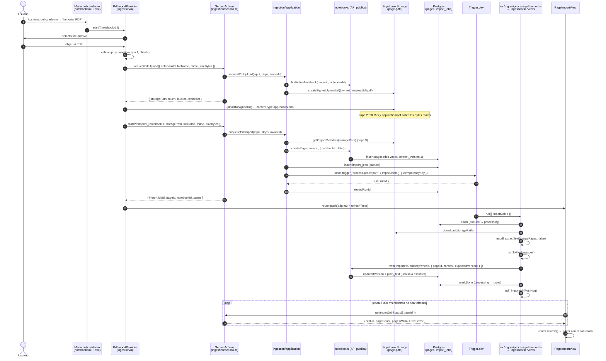
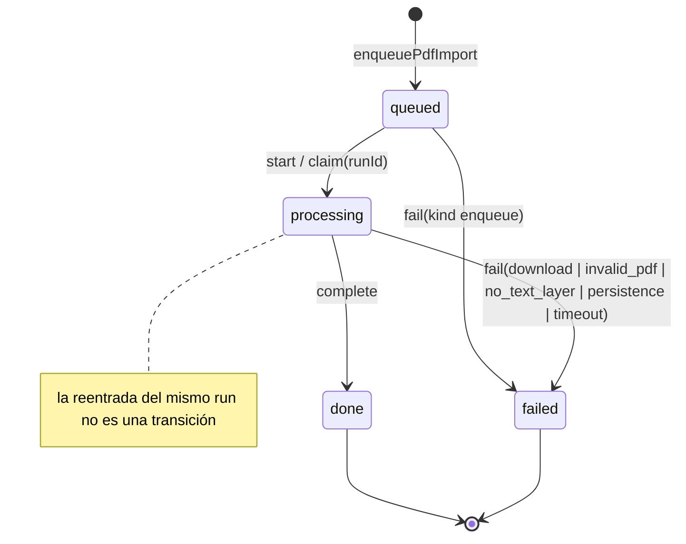

# Design: Fase 2 — Importación de PDF

> Change: `phase-2-pdf-import` · Store: hybrid (este archivo + Engram `sdd/phase-2-pdf-import/design` y `sdd/phase-2-pdf-import/design-part-2`) · Fecha: 2026-09-22 · Insumos: `proposal.md` (decisiones de producto 1–6 cerradas), `exploration.md`, delta specs de `specs/` (pdf-import, notebooks, design-tokens-and-shell, observability-and-delivery, project-tooling), `design.md` archivado de la Fase 1, `docs/documento-maestro.md` §5.2–§5.4, §6.1, §6.2, §8.1, §10.3, §13.

## Technical Approach

La Fase 2 aplica el Enfoque 1 de la propuesta: una Server Action delgada encola, una tarea de Trigger.dev v4 ejecuta y la UI consulta el estado por polling. El módulo `ingestion` deja de ser un esqueleto y adopta la forma hexagonal de `notebooks` (`domain/application/infrastructure/ui/index.ts`). Toda la lógica vive en `ingestion.domain` y `ingestion.application`, testeable con Vitest y fakes, sin Trigger.dev ni Supabase.

El diseño se alinea con las delta specs escritas en paralelo; **donde una regla de la spec y este diseño coinciden, la spec es la fuente de verdad**. Hay tres puntos donde el diseño encontró una restricción técnica que la spec no contempla; se documentan en la sección "Conflictos con la spec que requieren decisión" con una recomendación y una alternativa que cumple la spec al pie de la letra.

El hallazgo principal: **`src/modules/notebooks/index.ts` no se puede cargar tal cual desde un worker de Trigger.dev**. Reexporta `actions.ts` (que importa `next/cache` y `@/modules/identity`, y este a su vez `server-only` y `@sentry/nextjs`) y `ui/sidebar-tree.tsx` (que arrastra `@tanstack/react-query` y componentes `"use client"`). En Node plano, `server-only` lanza una excepción al cargarse. `src/shared/db/client.ts` y `src/shared/config/env.server.ts` también importan `server-only`. El diseño recomienda una segunda entrada pública por módulo, `server.ts`, libre de Next.js y React (ADR 0002), lo que requiere ajustar las reglas 5 y 10 de la spec `project-tooling`.

Resumen de la arquitectura:

- `notebooks` gana el caso de uso `writeImportedContent` (comparar-e-intercambiar sobre `content_version`) y la fábrica `createNotebooksServerApi`, expuesta en `notebooks/server.ts` y reexportada en `notebooks/index.ts`.
- `ingestion/index.ts` es la API pública para Next.js (Server Actions, componentes, tipos). `ingestion/server.ts` es la raíz de composición del worker y expone `runPdfImport`, lo único que llama la tarea de `src/trigger/`.
- La conversión texto→bloques es una función pura (`textToBlocks`) en `ingestion/domain`, con las reglas exactas de la spec `pdf-import`.
- El estado del job se consulta por `pageId` con polling de TanStack Query cada 2 000 ms; la vista de página oculta el editor mientras el job no es terminal.

## Conflictos con la spec que requieren decisión

Estos tres puntos se deben resolver antes de `sdd-tasks`. Para cada uno, el diseño recomienda una opción y detalla la alternativa que cumple la spec tal como está escrita.

### C1. Entrada del worker: `index.ts` (spec) frente a `server.ts` (recomendado)

- **Spec**: `project-tooling`, regla 5 ("un módulo solo se importa a través de su `index.ts`") y regla 10 ("`src/trigger/` importa módulos solo a través de su `index.ts`"); `notebooks`, requirement "Creación de página con contenido inicial" ("la API pública de `notebooks` (`index.ts`)").
- **Restricción**: cargar `@/modules/ingestion` o `@/modules/notebooks` (`index.ts`) en el worker arrastra `server-only` (lanza una excepción en Node sin la condición `react-server`), Next.js, React, React Query y el SDK de Sentry para Next.js.
- **Recomendado (A)**: segunda entrada pública `server.ts` (ADR 0002, Decision siguiente). Ajuste de spec: la regla 5 pasa a "a través de su `index.ts` o de su `server.ts`" y la regla 10 a "`src/trigger/` importa módulos solo a través de su `server.ts`". `notebooks/index.ts` también reexporta `createNotebooksServerApi`, así que el requirement de `notebooks` se cumple sin cambios.
- **Alternativa que cumple la spec (B)**: la tarea importa `@/modules/ingestion` (`index.ts`) y `trigger.config.ts` agrega un plugin de esbuild (extensión `esbuildPlugin` de `@trigger.dev/build`, nombre exacto a confirmar en la documentación de Trigger.dev) que resuelve `server-only` a un módulo vacío. Costos: el bundle del worker incluye Next.js, React, React Query y `@sentry/nextjs`, lo que alarga el arranque en frío (la etapa más incierta del presupuesto de 60 s); cualquier import nuevo con efectos de framework en `index.ts` rompe el worker en tiempo de ejecución sin que CI lo detecte. No se puede usar la condición `react-server` en su lugar: con ella `react` resuelve a su build de servidor, sin `createContext`, y la carga de React Query falla.

### C2. Filtro de rutas del deploy de Trigger.dev

- **Spec**: `observability-and-delivery`, "el job de deploy se ejecuta únicamente cuando el push modifica `src/trigger/**`, `trigger.config.ts`, `package.json` o `pnpm-lock.yaml`", con el escenario "push que solo modifica `src/modules/notebooks/ui` → deploy omitido".
- **Restricción**: la tarea empaqueta `ingestion` (domain, application, infrastructure, `server.ts`), la parte no visual de `notebooks` y `src/shared/**`. Un cambio en `textToBlocks` o en `writeImportedContent` no toca ninguna ruta del filtro y deja desplegada en producción una versión vieja de la lógica, sin ningún error visible.
- **Diseño**: se implementa el filtro exactamente como lo pide la spec (Decision "Deploy de Trigger.dev filtrado por rutas").
- **Ajuste de spec recomendado**: agregar al filtro `src/modules/ingestion/{domain,application,infrastructure}/**`, `src/modules/ingestion/server.ts`, `src/modules/notebooks/{domain,application,infrastructure}/**`, `src/modules/notebooks/server.ts` y `src/shared/**`. El escenario "solo `notebooks/ui` → omitido" sigue siendo verdadero.

### C3. Vigencia del permiso firmado y entorno de medición

- **Vigencia**: la spec exige un permiso de subida con vigencia de 10 minutos o menos. `createSignedUploadUrl` de Supabase no acepta un parámetro de expiración y su vigencia la fija la plataforma (2 horas según la documentación de Supabase, a confirmar en apply). **Diseño**: `RequestPdfUpload` devuelve `expiresAt = emisión + 10 min` y `EnqueuePdfImport` rechaza un objeto cuyo `uploadId` (UUID v7, que codifica su instante de creación en milisegundos) tenga más de 10 minutos. Así la vigencia efectiva para importar es de 10 minutos aunque Storage acepte bytes durante más tiempo; un objeto subido tarde queda huérfano y nunca se importa. No requiere cambio de spec si el revisor acepta esta lectura; si no, la spec debe decir "vigencia definida por la plataforma".
- **Medición**: la spec pide medir el presupuesto de 60 s "contra el entorno de preview con la tarea desplegada". Preview usa `cogni-dev` y la clave `tr_dev_` (ver Decision "Variables de entorno"), y en el entorno Development los runs los ejecuta el proceso local `pnpm trigger:dev`, no una tarea desplegada. **Diseño**: la medición oficial se hace en Preview como pide la spec (con `pnpm trigger:dev` corriendo) y se agrega una corrida en producción para medir el arranque en frío real, que Preview no incluye. Ajuste de spec recomendado: "contra preview, más una corrida en producción para la etapa de cola y arranque en frío".

## Architecture Decisions

### Decision: Entrada pública `server.ts` por módulo para consumidores sin Next.js (ADR 0002, opción A de C1)

**Choice**: además de `index.ts`, un módulo puede tener `src/modules/<módulo>/server.ts`, su API pública para código de servidor que corre fuera de Next.js (tareas de Trigger.dev) o que debe poder cargarse ahí (adaptadores de otros módulos usados por el worker). Reglas:

1. `server.ts` y todo lo que alcanza transitivamente no importa `next`, `react`, `react-dom`, `server-only`, `@sentry/nextjs` ni `@supabase/ssr`.
2. `server.ts` no reexporta Server Actions ni componentes; expone fábricas que reciben sus dependencias (`Db`, `Clock`) de forma explícita.
3. `index.ts` sigue siendo la entrada de `src/app/` y de todo consumidor de Next.js, y puede reexportar lo que expone `server.ts`.
4. `src/trigger/**` solo importa entradas `server.ts`, `src/shared/kernel/**` y `@trigger.dev/sdk`; nunca `src/shared/db` ni una capa `infrastructure` (regla 10 de la spec, ajustada).

Cambios en `.dependency-cruiser.cjs` (cada regla nueva entra con un test RED: archivo temporal que la viola, `pnpm depcruise` falla, se elimina el archivo):

```js
{
  name: "cross-module-via-index",
  comment:
    "a module may only be imported through its public index.ts or server.ts, never through internal paths.",
  severity: "error",
  from: { path: "^src/modules/([^/]+)/" },
  to: {
    path: "^src/modules/[^/]+/.+",
    pathNot: "^(src/modules/$1/|src/modules/[^/]+/(index|server)\\.ts$)",
  },
},
{
  name: "server-entry-is-framework-free",
  comment:
    "server.ts entries and Trigger.dev tasks run outside Next.js: they must never reach Next.js, React, server-only or the Next.js Sentry SDK.",
  severity: "error",
  from: { path: "^src/(modules/[^/]+/server\\.ts$|trigger/)" },
  to: {
    reachable: true,
    path: "^(node_modules/)?(next|react|react-dom|server-only|@sentry/nextjs|@supabase/ssr)(/|$)",
  },
},
{
  name: "trigger-tasks-are-thin",
  comment:
    "src/trigger tasks only import a module's server.ts entry, never shared/db or an infrastructure layer.",
  severity: "error",
  from: { path: "^src/trigger/" },
  to: {
    path: "^src/(modules/[^/]+/(?!server\\.ts$)|shared/db/)",
  },
},
{
  name: "trigger-sdk-only-in-infra-or-trigger",
  comment: "@trigger.dev/sdk lives only in infrastructure and src/trigger.",
  severity: "error",
  from: { path: "^src/(?!trigger/|modules/[^/]+/infrastructure/)" },
  to: { path: "^(node_modules/)?@trigger\\.dev/" },
},
{
  name: "unpdf-only-in-ingestion-infra",
  comment: "unpdf is an ingestion infrastructure detail.",
  severity: "error",
  from: { path: "^src/(?!modules/ingestion/infrastructure/)" },
  to: { path: "^(node_modules/)?unpdf(/|$)" },
},
```

Si `reachable: true` con destinos en `node_modules` no funciona con `doNotFollow: node_modules` en dependency-cruiser ^18.3.1, el fallback es una regla no transitiva sobre `src/modules/*/{server.ts,domain,application,infrastructure}` y `src/trigger/`, más un test de humo que importa `ingestion/server.ts` en Vitest con `environment: "node"` sin alias de `server-only`.

**Alternatives considered**: opción B de C1 (alias de `server-only` en el bundler del worker); condición `react-server` (rompe React Query); un route handler de Next.js que haga la escritura a pedido del worker (superficie HTTP nueva autenticada por secreto, otra ruta de fallo y más latencia); reescribir `notebooks/index.ts` para que no reexporte `actions.ts` ni la UI (rompe la composición de la Fase 1 en `src/app/`).

**Rationale**: la regla 5 existe para que un módulo no dependa de rutas internas de otro; una segunda entrada, explícita, pequeña y verificada por dependency-cruiser mantiene ese objetivo y además hace verificable que el worker no arrastra el framework web. Las fases 3 a 8 (IA por lotes, cálculo de repasos) tendrán el mismo problema. Es un cambio a una regla cerrada del documento maestro: se registra en `docs/adr/0002-entrada-server-para-workers.md` y se actualizan §5.3 (regla 5) y §5.4 (árbol con `server.ts`) en el mismo PR.

### Decision: `writeImportedContent` en `notebooks`, con comparar-e-intercambiar y reconocimiento de la propia escritura

**Choice**: caso de uso nuevo `src/modules/notebooks/application/write-imported-content.ts` y API de servidor mínima:

```ts
// src/modules/notebooks/server.ts
// Public API for server code that runs outside Next.js (ADR 0002).
// Nothing reachable from this file may import Next.js, React or server-only.
export interface NotebooksServerApi {
  // null when the notebook does not exist, belongs to another owner, or is archived.
  findActiveNotebook(ownerId: string, notebookId: string): Promise<{ id: string } | null>;
  // Same rules as CreatePage: owner, active notebook, title rules, position at the end.
  // An undefined title falls back to DEFAULT_PAGE_TITLE ("Sin título").
  createPage(
    ownerId: string,
    input: { notebookId: string; title?: string },
  ): Promise<Result<{ id: string; notebookId: string }, DomainError>>;
  // Writes the first real content of a page with an atomic compare-and-swap.
  writeImportedContent(
    ownerId: string,
    input: { pageId: string; content: TiptapDoc; expectedVersion: number },
  ): Promise<Result<{ version: number; alreadyApplied: boolean }, DomainError>>;
}

export function createNotebooksServerApi(deps: { db: Db; clock?: Clock }): NotebooksServerApi;
export { DEFAULT_PAGE_TITLE, NOTEBOOK_ERROR, PAGE_ERROR, TITLE_MAX_LENGTH } from "./domain";
export type { TiptapDoc, TiptapNode } from "./domain";
```

`notebooks/index.ts` reexporta `createNotebooksServerApi` y `NotebooksServerApi`, de modo que la API pública de `index.ts` también lo expone (requirement "Creación de página con contenido inicial desde una importación").

Invariantes de `writeImportedContent(input, { pages, clock }, ownerId)`:

1. Zod con `.strict()`: `{ pageId, content, expectedVersion }`. Un campo extra, en particular `plainText` o `plain_text`, hace fallar la validación (escenario "Contenido inválido rechazado"). El schema del documento (`type: "doc"`, nodos recursivos) se extrae de `save-page.ts` a `application/content-schema.ts` y lo reutilizan ambos casos de uso.
2. Un documento sin bloques se rechaza con `PAGE_INVALID_CONTENT`: el contenido inicial nunca es vacío.
3. La página debe existir, pertenecer a `ownerId` y no estar archivada; si no, `PAGE_NOT_FOUND` sin revelar si existe.
4. `plain_text` se calcula en el servidor con `extractPlainText(content)`.
5. Escritura única y atómica con `PageRepository.updateIfVersion({ expectedVersion })`: la página queda con el contenido completo y `content_version + 1`, o no cambia.
6. Si el `UPDATE` condicional no afecta filas, relee la página. Si su `content` es igual al documento recibido (igualdad profunda **insensible al orden de claves**, porque `jsonb` no conserva el orden de las claves) y su versión es `expectedVersion + 1`, devuelve `ok({ version, alreadyApplied: true })`: es la escritura de un intento anterior de la misma importación. En otro caso devuelve `PAGE_VERSION_CONFLICT` con el mensaje `current version is N`, el mismo código que `SavePage` (escenario "Página ya modificada rechazada").

La igualdad vive en `notebooks/domain/same-document.ts` (función pura, cobertura 100 %).

**Alternatives considered**: llamar a `savePage` con `expectedVersion: 1` (un reintento tras una escritura exitosa recibiría un conflicto y marcaría como fallida una importación correcta; además `SavePage` descarta `plain_text` en silencio en vez de rechazarlo); crear la página ya con contenido al final del procesamiento (la decisión de producto 3 exige crearla al encolar para navegar a ella); exponer `DrizzlePageRepository` a `ingestion` (filtraría la infraestructura de `notebooks`).

**Rationale**: la operación mínima con invariantes explícitas; `SavePage` y el autosave de la Fase 1 no cambian. Reconocer la propia escritura es seguro porque la conversión es determinista: el mismo PDF produce el mismo documento en cada intento.

### Decision: Módulo `ingestion` hexagonal con puertos propios y adaptador de Storage propio

**Choice**:

```
src/modules/ingestion/
├── domain/
│   ├── import-job.ts            # entity, start/complete/fail, isTerminal
│   ├── import-failure.ts        # failure kinds (Sentry categories) + UI-safe Spanish messages
│   ├── pdf-file.ts              # validatePdfInput, isOwnedPdfPath, uploadIdAgeMs, looksLikePdf, pageTitleFromFileName
│   ├── text-to-blocks.ts        # pure conversion, rules of spec pdf-import
│   ├── imported-doc.ts          # structural ImportedDoc type (Tiptap-compatible)
│   ├── import-job-repository.ts # port
│   ├── pdf-storage-gateway.ts   # port: signed upload + metadata + download
│   ├── pdf-text-extractor.ts    # port: bytes -> text per page
│   ├── import-job-enqueuer.ts   # port + PROCESS_PDF_IMPORT_TASK_ID
│   ├── notebook-pages-port.ts   # port: what ingestion needs from notebooks
│   ├── import-telemetry.ts      # port: stage logs, pdf_imported, Sentry
│   ├── errors.ts
│   └── index.ts
├── application/
│   ├── request-pdf-upload.ts
│   ├── enqueue-pdf-import.ts
│   ├── process-import-job.ts
│   ├── get-import-job-status.ts
│   ├── list-active-imports.ts
│   ├── validation.ts
│   ├── index.ts
│   └── testing/                 # in-memory fakes + shared repository contract
├── infrastructure/
│   ├── drizzle-import-job-repository.ts
│   ├── supabase-pdf-storage-gateway.ts
│   ├── unpdf-text-extractor.ts
│   ├── trigger-import-job-enqueuer.ts
│   ├── notebooks-pages-adapter.ts
│   ├── next-import-telemetry.ts
│   ├── worker-import-telemetry.ts
│   └── index.ts
├── ui/
│   ├── pdf-import-provider.tsx     # owns the hidden file input and the upload flow
│   ├── import-pdf-menu-item.tsx
│   ├── active-imports-provider.tsx # sidebar polling of non-terminal imports
│   ├── importing-page-badge.tsx
│   ├── import-progress.tsx         # six-state indicator (spec design-tokens-and-shell)
│   ├── page-import-view.tsx        # page-level polling, hides the editor
│   ├── upload-pdf-to-signed-url.ts
│   └── ingestion-copy.ts
├── actions.ts                   # "use server": Next.js composition root
├── server.ts                    # worker composition root (ADR 0002)
├── index.ts                     # Next.js public API
└── README.md
```

`ingestion` define su propio `PdfStorageGateway` y el adaptador `SupabasePdfStorageGateway` (unas 70 líneas) en vez de reutilizar `StorageGateway` de `notebooks`. El adaptador recibe `{ supabaseUrl, serviceRoleKey, bucket }` por constructor, sin leer variables de entorno, para servir en Next.js (valores de `serverEnv()`) y en el worker (valores de `workerEnv()`).

**Alternatives considered**: ampliar `StorageGateway` de `notebooks` con `download` y exponerlo (ensancha la API de `notebooks` para otro módulo y ata el pipeline al bucket `page-assets`, cuyo adaptador lee `SUPABASE_STORAGE_BUCKET` de forma fija); un adaptador compartido en `src/shared/storage/` (dos consumidores con buckets y operaciones distintas; se reevalúa con un tercero).

**Rationale**: duplicación pequeña y explícita; cada módulo es dueño de su bucket y sus límites; `ingestion` depende de `notebooks` solo por su API pública (§5.2).

### Decision: Tipo `ImportedDoc` estructural

**Choice**: `ingestion/domain/imported-doc.ts`:

```ts
export type ImportedText = { type: "text"; text: string };
export type ImportedParagraph = { type: "paragraph"; content: [ImportedText] };
export type ImportedHeading = { type: "heading"; attrs: { level: 1 | 2 | 3 }; content: [ImportedText] };
export type ImportedListItem = { type: "listItem"; content: [ImportedParagraph] };
export type ImportedBulletList = { type: "bulletList"; content: ImportedListItem[] };
// attrs.start is present only when the first item number is not 1 (spec rule 4).
export type ImportedOrderedList = { type: "orderedList"; attrs?: { start: number }; content: ImportedListItem[] };
export type ImportedBlock = ImportedParagraph | ImportedHeading | ImportedBulletList | ImportedOrderedList;
export type ImportedDoc = { type: "doc"; content: ImportedBlock[] };
```

Alias de tipo (no `interface`) para que `attrs` sea asignable a `Record<string, unknown>` de `TiptapNode`. `NotebooksPagesAdapter` pasa un `ImportedDoc` donde `notebooks` espera `TiptapDoc`; si las formas divergen, `tsc --noEmit` falla en ese adaptador.

**Alternatives considered**: importar `TiptapDoc` de `notebooks` en `domain` (prohibido por `domain-is-pure`); mover `TiptapDoc` a `shared/kernel` (el kernel no contiene formatos de documento).

**Rationale**: un tipo más estrecho documenta exactamente qué nodos produce la importación (decisión 5) y garantiza en compilación que no hay nodos de texto sin contenido.

### Decision: Algoritmo `textToBlocks`, reglas de la spec `pdf-import`

**Choice**: `textToBlocks(pages: string[]): TextToBlocksResult`:

```ts
export interface TextToBlocksResult {
  doc: ImportedDoc;
  totalPages: number;       // pages.length
  pagesWithText: number;
  pagesWithoutText: number; // pagesWithText + pagesWithoutText === totalPages
}
```

Cada página se convierte por separado y los bloques se concatenan en orden de página. Reglas, en el orden de la spec:

**P0. Página sin texto.** Tras la normalización (R1), una página cuyo texto es vacío o solo espacios en blanco es "sin texto": se cuenta en `pagesWithoutText` y no produce bloques.

**R1. Normalización.** `\r\n` y `\r` → `\n`; se eliminan los caracteres de control distintos de `\n` (incluido el guion suave `­`, que es un carácter de formato invisible); NBSP (` `) y los espacios Unicode (` - `, ` `, ` `, `　`) → espacio; en cada línea, toda secuencia de espacios y tabuladores → un espacio; `trim` de cada línea.

**R2. Líneas descartadas.** Una línea vacía es una línea en blanco. Una línea solo de dígitos (`/^\d+$/`) se descarta como numeración de página (no cuenta como línea en blanco ni como línea de texto).

**R3. Viñeta.** `^[-•*] (\S.*)$` → ítem de `bulletList`; el marcador se elimina.

**R4. Ítem ordenado.** `^(\d+)\) (\S.*)$` → siempre ítem de `orderedList`. `^(\d+)\. (\S.*)$` → ítem de `orderedList` solo si la línea no blanca inmediatamente anterior (en la misma página) es un ítem ordenado con número `N-1`, o la línea no blanca inmediatamente siguiente empieza con `N+1.` o `N+1)`. El marcador se elimina. La lista lleva `attrs.start` con el número del primer ítem solo cuando es distinto de 1.

**R5. Encabezado.** Una línea que no es ítem de lista es `heading` cuando: longitud ≤ 80, contiene al menos una letra (`\p{L}`), no termina en `.`, `,`, `;`, `:`, `!` ni `?`, y cumple al menos una de: (a) empieza con `N.` o con `N.N`, `N.N.N`… (con o sin punto final en el prefijo) seguido de un espacio; (b) empieza con un numeral romano válido en mayúsculas seguido de `.` y un espacio; (c) todas sus letras son mayúsculas (ninguna `\p{Ll}`). El texto conserva el prefijo tal como aparece.

**R6. Nivel.** Romano o prefijo de un segmento (`1.`) → 1; dos segmentos (`1.1`) → 2; tres o más → 3; mayúsculas sin prefijo → 1. Si hay prefijo y además mayúsculas, decide el prefijo. Un prefijo de varios segmentos nunca es ítem de lista: si no cumple la forma de R5, la línea es texto de párrafo.

**R7. Párrafo.** Toda línea que no es ítem ni encabezado es texto de párrafo. Líneas de párrafo consecutivas se unen en un solo `paragraph` con un espacio, salvo que la anterior termine en letra seguida de `-` (`/\p{L}-$/u`) y la siguiente empiece con minúscula (`/^\p{Ll}/u`): se unen sin espacio y sin el guion.

**R8. Continuación de ítem.** Una línea de párrafo inmediatamente después de un ítem, sin línea en blanco entre ambas, se anexa al texto del ítem con la regla de unión de R7.

**R9. Cierre.** Una o más líneas en blanco, un encabezado o un cambio de tipo de ítem (viñeta ↔ ordenado) cierran el párrafo o la lista en curso; un ítem de lista también cierra un párrafo abierto. Ítems consecutivos del mismo tipo forman una sola lista. Un encabezado nunca se une con otra línea. **El fin de página cierra el bloque abierto**: ningún bloque abarca dos páginas y no se inserta ningún nodo separador.

**R10. Salida.** Nunca se emiten nodos de texto vacíos ni bloques sin contenido. Listas planas, sin anidamiento. Los niveles 1–3 coinciden con el menú `/` del editor (`slash-command-items.ts`).

**Hueco de la spec resuelto aquí**: una página con texto que solo contiene numeración (por ejemplo `"12"`) cuenta como "con texto" según P0, pero no produce bloques. Si el documento final queda sin bloques, `ProcessImportJob` termina el job en `failed` con la categoría `no_text_layer`, porque el contenido inicial no puede ser vacío (invariante 2 de `writeImportedContent`). Ver Open Questions.

**Ejemplos trabajados** (fixtures de `text-to-blocks.test.ts`; `P("x")` = `paragraph`, `H(n,"x")` = `heading` de nivel `n`, `UL([...])` = `bulletList`, `OL([...])` = `orderedList` sin `attrs`, `OL(start,[...])` = `orderedList` con `attrs.start`; contadores `total/conTexto/sinTexto`):

| # | Entrada (`pages`) | Salida | Contadores |
|---|---|---|---|
| E1 | `["INTRODUCCIÓN\nLa memoria de trabajo es limitada.\n\nPor eso conviene repasar."]` | `H(1,"INTRODUCCIÓN")`, `P("La memoria de trabajo es limitada.")`, `P("Por eso conviene repasar.")` | 1/1/0 |
| E2 | `["La mitocondria produce ener-\ngía para la célula y\nparticipa en la apoptosis."]` | `P("La mitocondria produce energía para la célula y participa en la apoptosis.")` | 1/1/0 |
| E3 | `["1. Introducción\n1.1 Contexto histórico\n1.1.1 Antecedentes"]` | `H(1,"1. Introducción")`, `H(2,"1.1 Contexto histórico")`, `H(3,"1.1.1 Antecedentes")` | 1/1/0 |
| E4 | `["II. Marco teórico\nCAPÍTULO 2"]` | `H(1,"II. Marco teórico")`, `H(1,"CAPÍTULO 2")` | 1/1/0 |
| E5 | `["Introducción"]` | `P("Introducción")` | 1/1/0 |
| E6 | `["1. La célula es la unidad básica."]` | `P("1. La célula es la unidad básica.")` (aislado y con punto final: ni lista ni encabezado) | 1/1/0 |
| E7 | `["1. Preparar el material\n2. Leer el capítulo\n3. Resumir\n\n1. Conclusiones"]` | `OL(["Preparar el material","Leer el capítulo","Resumir"])`, `H(1,"1. Conclusiones")` | 1/1/0 |
| E8 | `["3) Tercer paso\n4) Cuarto paso"]` | `OL(3,["Tercer paso","Cuarto paso"])` | 1/1/0 |
| E9 | `["- Primera idea\n• Segunda idea\n* Tercera idea"]` | `UL(["Primera idea","Segunda idea","Tercera idea"])` | 1/1/0 |
| E10 | `["- Un ítem que continúa\nen la línea siguiente\n\nPárrafo aparte"]` | `UL(["Un ítem que continúa en la línea siguiente"])`, `P("Párrafo aparte")` | 1/1/0 |
| E11 | `["Primer párrafo\n\n\n12\nSegundo párrafo"]` | `P("Primer párrafo")`, `P("Segundo párrafo")` | 1/1/0 |
| E12 | `["  Texto\tcon   espacios raros  \r\n"]` | `P("Texto con espacios raros")` | 1/1/0 |
| E13 | `["- Viñeta\n1) Ordenado"]` | `UL(["Viñeta"])`, `OL(["Ordenado"])` | 1/1/0 |
| E14 | `["termina aquí", "y sigue acá"]` | `P("termina aquí")`, `P("y sigue acá")` (el salto de página cierra el párrafo) | 2/2/0 |
| E15 | `["Página uno.", "   \n\n", "Página tres."]` | `P("Página uno.")`, `P("Página tres.")` | 3/2/1 |
| E16 | `["", " \n\t", "   "]` | documento con `content` vacío, sin excepción | 3/0/3 |
| E17 | `["", "12"]` | documento con `content` vacío; `ProcessImportJob` falla con `no_text_layer` (hueco resuelto arriba) | 2/1/1 |
| E18 | `["Objetivos:\nADN Y ARN.\nUNESCO"]` | `P("Objetivos: ADN Y ARN.")`, `H(1,"UNESCO")` | 1/1/0 |
| E19 | `["1. Primer punto largo que\nsigue en otra línea.\n2. Segundo punto"]` | `H(1,"1. Primer punto largo que")`, `P("sigue en otra línea.")`, `H(1,"2. Segundo punto")` (limitación conocida de R4: una continuación entre ítems `N.` rompe la vecindad) | 1/1/0 |
| E20 | `["1. Uno\n\n2. Dos"]` | `OL(["Uno"])`, `OL(2,["Dos"])` (R4 ignora líneas en blanco al buscar vecinos, pero R9 cierra la lista en la línea en blanco) | 1/1/0 |

**Alternatives considered**: las reglas de la versión previa de este diseño que la spec no incluye (quitar encabezados y pies repetidos entre páginas, cortar párrafos por línea corta, unir párrafos entre páginas, descartar "Página N de M") se retiran para cumplir la spec; quedan como mejoras posibles en Open Questions si la calidad medida con PDFs reales lo justifica.

**Rationale**: reglas puras, deterministas y con ejemplos exactos permiten Strict TDD y cobertura del 100 %. E19 y E20 documentan comportamientos de la spec que conviene conocer antes de apply.

### Decision: Entidad `ImportJob` y transiciones de la spec

**Choice**: `ingestion/domain/import-job.ts` con las funciones `start`, `complete` y `fail` que nombra la spec:

```ts
export const IMPORT_JOB_STATUS = ["queued", "processing", "done", "failed"] as const;
export type ImportJobStatus = (typeof IMPORT_JOB_STATUS)[number];

export interface ImportJob {
  readonly id: string;
  readonly ownerId: string;
  readonly pageId: string;
  readonly storagePath: string;
  readonly fileName: string;
  readonly sizeBytes: number;           // from the real Storage object
  readonly status: ImportJobStatus;
  readonly pageCount: number | null;    // null until known
  readonly pagesWithoutText: number;    // starts at 0
  readonly error: string | null;        // UI-safe Spanish message, only when failed
  readonly triggerRunId: string | null;
  readonly startedAt: Date | null;      // extra column, used to measure queue time
  readonly finishedAt: Date | null;     // terminal instant (spec: MAY)
  readonly createdAt: Date;
  readonly updatedAt: Date;
}

// queued -> processing. On a job already in processing for the same run it
// returns the job unchanged (retry of the same run), which is not a transition.
export function start(job: ImportJob, runId: string, clock: Clock): Result<ImportJob, DomainError>;
// processing -> done. Requires pageCount known and pagesWithoutText < pageCount.
export function complete(
  job: ImportJob,
  counts: { pageCount: number; pagesWithoutText: number },
  clock: Clock,
): Result<ImportJob, DomainError>;
// processing -> failed (any kind), or queued -> failed only for kind "enqueue".
// Requires a non-empty message after trim. Counts are optional (no-text case).
export function fail(
  job: ImportJob,
  failure: { kind: ImportFailureKind; message: string; pageCount?: number; pagesWithoutText?: number },
  clock: Clock,
): Result<ImportJob, DomainError>;
export function isTerminal(status: ImportJobStatus): boolean;
```

Toda transición desde `done` o `failed`, `fail` desde `queued` con un tipo distinto de `enqueue`, `complete` con contadores inválidos y `fail` con mensaje vacío devuelven `DomainError("IMPORT_JOB_INVALID_TRANSITION")` sin modificar el job. Cobertura 100 %.

`ingestion/domain/import-failure.ts` define los tipos de fallo (que son las categorías de Sentry de la spec `observability-and-delivery`) y el mensaje en español que se guarda en `error`:

| `ImportFailureKind` | Causa | Mensaje en `error` |
|---|---|---|
| `download` | objeto inexistente o descarga agotada | "No pudimos leer el archivo que subiste. Vuelve a importarlo." |
| `invalid_pdf` | no empieza con `%PDF-`, excede 20 MiB o `unpdf` no lo puede abrir | "Este archivo no es un PDF válido o está protegido. Revisa que no tenga contraseña e inténtalo de nuevo." |
| `no_text_layer` | ninguna página con texto o ningún bloque | "Este PDF no tiene texto seleccionable y Cogni no hace OCR. Prueba con un PDF que tenga texto." |
| `persistence` (conflicto) | `PAGE_VERSION_CONFLICT` | "La página cambió durante la importación, así que no reemplazamos su contenido. Vuelve a importar el PDF." |
| `persistence` (página) | `PAGE_NOT_FOUND` (archivada) | "La página de destino ya no está disponible. Vuelve a importar el PDF." |
| `timeout` | `maxDuration` superado | "La importación tardó demasiado. Inténtalo de nuevo en unos minutos." |
| `enqueue` | `tasks.trigger` falló | "No pudimos iniciar la importación. Inténtalo de nuevo en unos minutos." |

Los mensajes viven en `domain` porque los escribe tanto el worker como la Server Action y deben ser idénticos; nunca contienen trazas, rutas, URLs firmadas ni nombres de variables (requirement "Errores seguros para la interfaz").

Puerto del repositorio (cada transición es un `UPDATE` condicional atómico con `RETURNING`, como `updateIfVersion` de la Fase 1):

```ts
export interface ImportJobRepository {
  create(job: ImportJob): Promise<void>;
  findById(id: string): Promise<ImportJob | null>;
  findByStoragePath(storagePath: string): Promise<ImportJob | null>;
  findLatestByPage(pageId: string): Promise<ImportJob | null>;
  listActivePageIds(ownerId: string): Promise<string[]>; // queued or processing
  // queued -> processing, or same-run re-entry on processing. null otherwise.
  claim(input: { id: string; runId: string; now: Date }): Promise<ImportJob | null>;
  recordRunId(input: { id: string; runId: string; now: Date }): Promise<void>; // only when null
  // processing -> done. null when nothing changed.
  markDone(input: { id: string; pageCount: number; pagesWithoutText: number; now: Date }): Promise<ImportJob | null>;
  // processing -> failed, or queued -> failed when kind is "enqueue". null when nothing changed.
  markFailed(input: {
    id: string;
    kind: ImportFailureKind;
    message: string;
    pageCount?: number;
    pagesWithoutText?: number;
    now: Date;
  }): Promise<ImportJob | null>;
}
```

```sql
-- claim
update import_jobs
set status = 'processing',
    trigger_run_id = coalesce(trigger_run_id, $runId),
    started_at = coalesce(started_at, $now),
    updated_at = $now
where id = $id
  and (status = 'queued' or (status = 'processing' and trigger_run_id = $runId))
returning *;
```

Un test de contrato compartido (`application/testing/import-job-repository.contract.ts`) corre contra `InMemoryImportJobRepository` (`pnpm test`) y `DrizzleImportJobRepository` (`pnpm test:db`).

**Alternatives considered**: transiciones solo en SQL (pierde la cobertura pura); `pgEnum` para `status` (reversión y evolución más costosas que un `check`); guardar un código en `error` y traducirlo en la UI (la spec exige que `error` sea el texto legible en español).

**Rationale**: las funciones puras fijan las reglas; los `UPDATE` condicionales garantizan que dos ejecuciones o un reintento nunca dupliquen trabajo ni reabran un estado terminal.

### Decision: Tabla `import_jobs` solo accesible desde el servidor

**Choice**: en `src/shared/db/schema.ts`:

```ts
export const importJobs = pgTable(
  "import_jobs",
  {
    id: uuid("id").primaryKey(),
    ownerId: uuid("owner_id").notNull().references(() => profiles.id, { onDelete: "cascade" }),
    pageId: uuid("page_id").notNull().references(() => pages.id, { onDelete: "cascade" }),
    storagePath: text("storage_path").notNull(),
    fileName: text("file_name").notNull(),
    sizeBytes: integer("size_bytes").notNull(),
    status: text("status").notNull().default("queued"),
    pageCount: integer("page_count"),
    pagesWithoutText: integer("pages_without_text").notNull().default(0),
    error: text("error"),
    triggerRunId: text("trigger_run_id"),
    startedAt: timestamp("started_at", { withTimezone: true }),
    finishedAt: timestamp("finished_at", { withTimezone: true }),
    createdAt: timestamp("created_at", { withTimezone: true }).notNull().defaultNow(),
    updatedAt: timestamp("updated_at", { withTimezone: true }).notNull().defaultNow(),
  },
  (table) => [
    index("import_jobs_page_id_idx").on(table.pageId),
    index("import_jobs_owner_status_idx").on(table.ownerId, table.status),
    unique("import_jobs_storage_path_key").on(table.storagePath),
    check("import_jobs_status_check", sql`${table.status} in ('queued', 'processing', 'done', 'failed')`),
  ],
).enableRLS();
```

`enableRLS()` sin políticas, como `pages`: solo la conexión del servidor accede (§6.2). `id` es UUID v7 de `createId()`. Migración generada `drizzle/0005_import_jobs.sql` con reversión `drizzle/0005_import_jobs.down.sql` (`drop table import_jobs;`); ninguna tabla depende de `import_jobs`. `size_bytes`, `started_at` y `finished_at` son columnas adicionales a la lista de la spec: `size_bytes` persiste el tamaño real del objeto (la spec exige que los valores persistidos vengan del objeto real) y `started_at`/`finished_at` permiten medir la espera en cola y la duración. `import_jobs_owner_status_idx` sirve a `listActivePageIds` (sidebar).

**Rationale**: §6.1 más la decisión 6 y la medición del presupuesto. La versión previa de este diseño tenía `notebook_id`; se retira porque la URL de la página ya la conoce la UI (resultado del encolado y parámetros de la ruta).

### Decision: Bucket privado `page-pdfs` por migración, con lectura, escritura y borrado propios

**Choice**: `drizzle/0006_page_pdfs_storage.sql`, escrita a mano y registrada en el journal (`pnpm drizzle-kit generate --custom --name page_pdfs_storage`), con `0006_page_pdfs_storage.down.sql`:

```sql
-- Same pattern as 0004_page_assets_storage.sql (raw SQL; Drizzle does not
-- introspect the storage schema). page-assets is not touched.
insert into storage.buckets (id, name, public, file_size_limit, allowed_mime_types)
values ('page-pdfs', 'page-pdfs', false, 20971520, array['application/pdf'])
on conflict (id) do update set
  public = excluded.public,
  file_size_limit = excluded.file_size_limit,
  allowed_mime_types = excluded.allowed_mime_types;
--> statement-breakpoint
create policy "page-pdfs read own"
  on storage.objects for select
  using (bucket_id = 'page-pdfs' and (storage.foldername(name))[1] = auth.uid()::text);
--> statement-breakpoint
create policy "page-pdfs write own"
  on storage.objects for insert
  with check (bucket_id = 'page-pdfs' and (storage.foldername(name))[1] = auth.uid()::text);
--> statement-breakpoint
create policy "page-pdfs delete own"
  on storage.objects for delete
  using (bucket_id = 'page-pdfs' and (storage.foldername(name))[1] = auth.uid()::text);
```

```sql
-- 0006_page_pdfs_storage.down.sql
drop policy if exists "page-pdfs read own" on storage.objects;
drop policy if exists "page-pdfs write own" on storage.objects;
drop policy if exists "page-pdfs delete own" on storage.objects;
delete from storage.objects where bucket_id = 'page-pdfs';
delete from storage.buckets where id = 'page-pdfs';
```

Ruta canónica asignada por el servidor: `{ownerId}/{uploadId}.pdf`, con `uploadId = createId()` (UUID v7).

**Alternatives considered**: solo política de inserción (versión previa de este diseño, mínimo privilegio); se descarta porque la spec exige leer, escribir y borrar solo lo propio. `{ownerId}/{pageId}/…` (la página no existe cuando se emite el permiso).

**Rationale**: cumple el requirement "Bucket privado `page-pdfs`" y repite el patrón probado de `0004`.

### Decision: Flujo de subida y encolado

**Choice**: casos de uso de `application`, expuestos como Server Actions delgadas en `ingestion/actions.ts` con el patrón `Result<T, ActionError>` de `requestImageUpload` (sesión con `requireOwnerIdResult`, `toActionError` en el borde; `ownerId` siempre de la sesión):

1. **`requestPdfUpload({ notebookId, fileName, mime, sizeBytes })`**: `fileName` no vacío tras `trim` y ≤ 255; `mime === "application/pdf"`; `0 < sizeBytes ≤ 20 971 520`; cuaderno activo y propio (`findActiveNotebook`); cualquier fallo → `DomainError` sin contactar Storage. Devuelve `{ storagePath, token, bucket, expiresAt }` con `expiresAt = ahora + 10 min` (ver C3).
2. **Subida directa**: el navegador llama `supabase.storage.from(bucket).uploadToSignedUrl(path, token, file, { contentType: "application/pdf" })`. El `contentType` se fija porque algunos navegadores entregan `file.type` vacío y el bucket rechaza cualquier otro tipo.
3. **`startPdfImport({ notebookId, storagePath, fileName, mime, sizeBytes })`** → `enqueuePdfImport`:
   1. `isOwnedPdfPath(ownerId, storagePath)`: forma exacta `{ownerId}/{uuid v7}.pdf` (cumple y endurece "comienza con `{ownerId}/`"); si no, `PDF_PATH_OUT_OF_SCOPE` sin consultar Storage.
   2. Idempotencia: si existe un job con ese `storage_path` del mismo dueño, se devuelve (sin página ni run nuevos).
   3. `uploadIdAgeMs(storagePath, now) > 10 min` → `PDF_UPLOAD_EXPIRED` (C3).
   4. Cuaderno activo y propio, de nuevo.
   5. Metadatos reales (`getObjectMetadata`): inexistente → `PDF_OBJECT_MISSING`; tipo real distinto de `application/pdf` o tamaño real > 20 MiB → `DomainError`; nada creado.
   6. Crea la página con `createPage(ownerId, { notebookId, title })`, `title = pageTitleFromFileName(fileName)`: quita directorios y la extensión `.pdf` (sin distinguir mayúsculas), colapsa espacios, `trim`, trunca a 120 caracteres; si queda vacío, `undefined` para que `notebooks` aplique "Sin título".
   7. Crea el `ImportJob` en `queued` con `sizeBytes` del objeto real.
   8. `enqueuer.enqueue({ importJobId })`; si lanza, `markFailed(kind: "enqueue")`, `telemetry.finished(job, failure)` y devuelve el job en `failed` (la página queda vacía y editable).
   9. `recordRunId`. Devuelve `{ importJobId, pageId, notebookId, status }`; la acción llama `revalidatePath("/", "layout")`.
4. **`getImportJobStatus({ pageId })`** (solo lectura): sin job → `ok(null)` ("no hay importación"); job de otro dueño → `IMPORT_JOB_NOT_FOUND` sin revelar existencia; si no, `ImportJobStatusView` sin `storage_path` ni `trigger_run_id`.
5. **`getActiveImports()`** → `listActiveImports(ownerId)`: ids de páginas con job `queued` o `processing` del dueño (solo lectura), para el indicador del sidebar.

```ts
export interface PdfUploadGrant {
  storagePath: string;
  signedUrl: string;
  token: string;
  bucket: string;
  expiresAt: string; // ISO, at most 10 minutes after issue
}

export interface ImportJobStatusView {
  importJobId: string;
  pageId: string;
  status: ImportJobStatus;
  pageCount: number | null;
  pagesWithoutText: number;
  error: string | null;
  createdAt: string;
  updatedAt: string;
}
```

**Alternatives considered**: crear página y job en `requestPdfUpload` (deja páginas huérfanas si la subida falla, contra el escenario "Fallo de subida no deja página"); una Server Action que reciba el archivo (límite de 1 MB y prohibido por el requirement "Subida directa"); disparar la tarea desde el navegador (expondría credenciales de Trigger.dev).

**Rationale**: patrón de tres capas de `page-assets`. La página se crea solo cuando el objeto existe y es válido. El orden página → job → encolado no es atómico entre módulos: si falla la inserción del job después de crear la página, queda una página vacía con el nombre del archivo, visible y archivable (riesgo bajo, aceptado).

### Decision: Tarea de Trigger.dev delgada, reintentos e idempotencia

**Choice**: `src/trigger/process-pdf-import.ts`:

```ts
import { logger, task } from "@trigger.dev/sdk";
import { failPdfImportAfterRetries, runPdfImport } from "@/modules/ingestion/server";

export const processPdfImport = task({
  id: "process-pdf-import", // PROCESS_PDF_IMPORT_TASK_ID
  maxDuration: 300, // seconds of compute; spec ceiling
  retry: { maxAttempts: 3, factor: 2, minTimeoutInMs: 1000, maxTimeoutInMs: 5000, randomize: true },
  run: async (payload: { importJobId: string }, { ctx }) => {
    const outcome = await runPdfImport({ importJobId: payload.importJobId, runId: ctx.run.id });
    logger.info("pdf import finished", { importJobId: payload.importJobId, outcome: outcome.outcome });
    return outcome;
  },
  // Every attempt failed or maxDuration was exceeded: end the job in failed.
  onFailure: async ({ payload, error }) => {
    await failPdfImportAfterRetries({ importJobId: payload.importJobId, error });
  },
});
```

`processImportJob({ importJobId, runId }, deps)` (el `ownerId` sale del job persistido; la entrada no admite ningún campo de dueño):

1. `findById`: inexistente → `err(IMPORT_JOB_NOT_FOUND)`, sin escribir nada; `runPdfImport` lo devuelve como `outcome: "not_found"` sin lanzar, para que no se reintente.
2. Estado terminal → `ok({ outcome: "skipped" })` sin descargar ni escribir (requirement "Idempotencia").
3. `claim(id, runId)`: `null` (otro run lo tiene) → `skipped`.
4. `download(storagePath)`: `null` → `fail(download)`. Una excepción de red se propaga para que Trigger.dev reintente; la excepción lleva la etapa (`StageError { stage: "download" }`) para que `onFailure` elija la categoría.
5. `looksLikePdf(bytes)` y `bytes.length ≤ 20 MiB`; si no, `fail(invalid_pdf)`.
6. `extractor.extract(bytes)`: `err` → `fail(invalid_pdf)`.
7. `textToBlocks(pages)`: `pagesWithText = 0` o documento sin bloques → `fail(no_text_layer)` con `pageCount = totalPages` y `pagesWithoutText` reales.
8. `pagesPort.writeImportedContent(ownerId, { pageId, content, expectedVersion: 1 })`: `PAGE_VERSION_CONFLICT` o `PAGE_NOT_FOUND` → `fail(persistence)` y la página conserva su contenido; `alreadyApplied` continúa.
9. `markDone({ pageCount: totalPages, pagesWithoutText })`.
10. Cada `markDone`/`markFailed` que devuelve el job (hubo transición) llama `telemetry.finished(job, failure?)`, que emite `pdf_imported` y, si falló, Sentry.

Los fallos clasificados (pasos 4–8) marcan `failed` sin lanzar y no se reintentan: un PDF sin texto seguirá sin texto. Solo los errores transitorios lanzan. `failPdfImportAfterRetries` usa `kind: "timeout"` si el error es de duración máxima excedida y, en otro caso, la etapa del `StageError` (`download` o `persistence`); si no hay etapa, `download`.

| Situación | Resultado |
|---|---|
| Server Action reintentada con el mismo `storagePath` | `findByStoragePath` devuelve el job; sin página ni run nuevos |
| `tasks.trigger` duplicado | `idempotencyKey: importJobId`; aun con dos runs, `claim` deja pasar a uno solo |
| Reintento del mismo run antes de escribir | `claim` acepta la reentrada y repite el trabajo |
| Reintento después de escribir y antes de `markDone` | `writeImportedContent` reconoce su escritura (`alreadyApplied`); `markDone` transiciona una vez |
| Reintento o run nuevo sobre un job terminal | `skipped`; sin descarga, sin escritura, sin segundo `pdf_imported` |
| Reintentos agotados o `maxDuration` superado | `onFailure` → `markFailed` (`timeout`, `download` o `persistence`) |

`trigger.config.ts`:

```ts
import { defineConfig } from "@trigger.dev/sdk";

export default defineConfig({
  project: "proj_XXXXXXXXXXXXXXXX", // project ref, not a secret (user step A)
  dirs: ["./src/trigger"],
  runtime: "node",
  maxDuration: 300,
  retries: {
    enabledInDev: false,
    default: { maxAttempts: 3, factor: 2, minTimeoutInMs: 1000, maxTimeoutInMs: 5000, randomize: true },
  },
});
```

La máquina queda en el valor por defecto; si la medición supera el presupuesto, el primer ajuste es subir `machine` en la tarea (preset a confirmar en la documentación de Trigger.dev v4).

**Rationale**: §5.4 exige tareas delgadas; toda la lógica está en `processImportJob`. `claim` condicional, escritura reconocible y transiciones condicionales garantizan un contenido, un estado terminal y un evento por job.

### Decision: Composición del worker sin `server-only`

**Choice**:

- `src/shared/db/create-db.ts` (nuevo, sin `server-only`): `createDb(url)` y el tipo `Db`. `client.ts` conserva `import "server-only"` y `getDb()` usa `createDb(serverEnv().DATABASE_URL)`. Los repositorios Drizzle importan el tipo `Db` desde `create-db.ts`.
- `env.schema.ts` agrega `workerSchema`/`parseWorkerEnv`; `src/shared/config/env.worker.ts` (nuevo, sin `server-only`) expone `workerEnv()`:

```ts
export const workerSchema = z.object({
  DATABASE_URL: z.string().url(),
  NEXT_PUBLIC_SUPABASE_URL: supabaseProjectUrl,
  SUPABASE_SERVICE_ROLE_KEY: z.string().min(1),
  SUPABASE_PDF_BUCKET: z.string().min(1),
  NEXT_PUBLIC_POSTHOG_KEY: z.string().min(1).optional(),
  NEXT_PUBLIC_POSTHOG_HOST: z.string().url().optional(),
  SENTRY_DSN: z.string().url().optional(),
});
```

`ingestion/server.ts` es el único lugar que llama `createDb(workerEnv().DATABASE_URL)` (una conexión por proceso, `max: 1`). La regla 10 de la spec prohíbe que `src/trigger/` importe `src/shared/db`; la tarea no lo hace: pasa por `ingestion/server.ts`.

**Alternatives considered**: quitar `server-only` de `client.ts` y `env.server.ts` (perdería la protección que impide que `SUPABASE_SERVICE_ROLE_KEY` llegue a un bundle de cliente).

**Rationale**: separa la fábrica pura de la protección de Next.js sin debilitarla; `server-entry-is-framework-free` lo verifica.

### Decision: Vista de página y polling con TanStack Query

**Choice**:

- La ruta `src/app/(app)/notebooks/[notebookId]/pages/[pageId]/page.tsx` llama `getImportJobStatus({ pageId })` en el servidor y renderiza `<PageImportView initial={view} editor={<Editor … />} />` de `@/modules/ingestion` (el `Editor` se pasa como elemento, así `ingestion` no importa `editor`).
- `PageImportView` (cliente):
  - Job `queued` o `processing`: muestra `ImportProgress` y **no** renderiza el editor (no hay ningún control para escribir; requirement "Rutas de cuaderno y página").
  - Consulta con `useQuery({ queryKey: ["ingestion", "page-import", pageId], queryFn, initialData, refetchInterval: (q) => shouldPoll(q.state.data) ? 2000 : false, retry: false })`. `shouldPoll` es falso con `done`, `failed` o `null`. Un error de la consulta conserva el último dato (TanStack Query mantiene `data` al fallar) y el siguiente intervalo vuelve a consultar; el estado de error del job nunca se deriva de un error de red.
  - A los 90 s sin estado terminal muestra el aviso de demora y **sigue** consultando (sin límite de espera en el cliente, como pide la spec). El polling se detiene al desmontar.
  - Al llegar a `done` o `failed` llama `router.refresh()` una vez: la ruta vuelve a renderizar con el contenido y el `content_version` vigentes, y `PageImportView` muestra el editor. Con `failed` muestra además `ImportProgress` en estado de error encima del editor vacío; con `done` y `pagesWithoutText > 0`, el aviso de páginas omitidas encima del editor.
- Sidebar: `ActiveImportsProvider` (cliente, montado en el layout con los ids iniciales de `getActiveImports()`) consulta `getActiveImports` cada 2 000 ms solo mientras la lista no está vacía; `PdfImportProvider` agrega el `pageId` recién creado. `ImportingPageBadge` muestra un ícono `LoaderCircle` en color de texto muted con `aria-label="Importando PDF"` junto a las páginas de esa lista; al terminar el job desaparece sin recargar.

**Alternatives considered**: Trigger.dev Realtime (decisión 2); mostrar el editor vacío durante la importación (permitiría escribir y provocaría un conflicto); consultar el estado por `importJobId` (la spec define la consulta por `pageId`, que además no requiere que la UI conserve el id del job); un límite de espera en el cliente (la spec pide seguir consultando).

**Rationale**: reemplazar el editor por el progreso elimina la única carrera real entre el usuario y el worker; `router.refresh()` reutiliza el renderizado de servidor.

### Decision: Menú de acciones del cuaderno con slot inyectado desde la raíz de composición

**Choice**: `notebooks` no puede importar `ingestion` (§5.2) y una función de render no cruza la frontera Server → Client Component. Además, el `<input type="file">` no puede vivir dentro del contenido del menú: Radix lo desmonta al cerrarse y se perdería el evento `change`.

1. `notebooks/ui/notebook-actions-slot.tsx` (`"use client"`, exportado en `notebooks/index.ts`): contexto con un `Provider` que recibe `menuItems: (notebook: { id: string; title: string }, helpers: { refreshTree: () => void }) => ReactNode` y `pageBadge: (page: { id: string }) => ReactNode`. `refreshTree` invalida `["notebooks", "sidebar-tree"]`, clave que sigue siendo privada de `notebooks`.
2. `notebooks/ui/notebook-item.tsx` agrega un botón `MoreHorizontal` (`aria-label="Acciones de {título}"`) que abre un `DropdownMenu` de `src/shared/ui/dropdown-menu.tsx` con los ítems del slot. Radix da navegación con flechas y activación con `Enter` (escenario "Entrada Importar PDF en el menú del cuaderno"). Los botones existentes de crear página y archivar se conservan tal cual, para no romper los selectores de los e2e de la Fase 1. `page-item.tsx` renderiza `pageBadge(page)`.
3. `ingestion/ui/pdf-import-provider.tsx` (`"use client"`): dueño del único `<input type="file" accept="application/pdf" hidden>` y del flujo (validación en cliente → `requestPdfUpload` → subida → `startPdfImport` → `router.push` a la página → `refreshTree`). Mientras sube muestra `ImportProgress` en estado `uploading`, y si algo falla antes del encolado muestra el error (`role="alert"`) en una región sobre el árbol del sidebar, sin navegar y sin crear página.
4. `ingestion/ui/import-pdf-menu-item.tsx`: `DropdownMenuItem` con ícono `FileUp` y texto "Importar PDF" que llama `pdfImport.start({ notebookId, onPageCreated: refreshTree })`.
5. `src/app/(app)/_components/notebook-actions.tsx` (`"use client"`, raíz de composición): monta `PdfImportProvider`, `ActiveImportsProvider` y `NotebookActionsSlotProvider` con `menuItems={(nb, h) => <ImportPdfMenuItem notebook={nb} onImported={h.refreshTree} />}` y `pageBadge={(p) => <ImportingPageBadge pageId={p.id} />}`. `layout.tsx` envuelve `<SidebarTree />` con este componente.

`ingestion/index.ts` debe seguir siendo importable desde un Client Component: solo reexporta Server Actions (`"use server"`), componentes (`"use client"`), tipos y constantes puras; nunca `infrastructure` ni `server.ts`.

**Alternatives considered**: botón con ícono visible al pasar el cursor (versión previa de este diseño; la spec exige un menú navegable con flechas); el botón en la vista de cuaderno (contradice la decisión 3 y la spec); que `notebooks/ui` importe `ingestion` (ciclo de dependencias).

**Rationale**: la inversión de dependencias por slot respeta §5.2 y deja la composición en `src/app/`. El menú es extensible para acciones de fases futuras (por ejemplo, generar flashcards de un cuaderno).

### Decision: Indicador de progreso y copy (spec `design-tokens-and-shell`, skill `cogni-design`)

**Choice**: `ingestion/ui/import-progress.tsx` recibe `state: "uploading" | "queued" | "processing" | "done" | "failed"` más `pagesWithoutText` y `error`. Textos en `ingestion-copy.ts`, en español con "tú", oración con minúscula inicial, sin emoji:

| Estado | Texto | Rol accesible | Token de color |
|---|---|---|---|
| `uploading` | "subiendo el archivo…" | `role="status"`, `aria-live="polite"` | acento violeta |
| `queued` | "en cola" | `status` | acento violeta |
| `processing` | "procesando el PDF…" | `status` | acento violeta |
| `done` sin omitidas | "listo" | `status` | semántico verde |
| `done` con omitidas | "N páginas no tenían texto y se omitieron" (N real; con 1: "1 página no tenía texto y se omitió") | `status` | semántico ámbar |
| `failed` | el `error` del job | `role="alert"` | semántico rojo |
| demora (90 s) | "la importación está tardando más de lo esperado; esta página se actualizará sola" | `status` | texto muted |

Mensajes de validación en el cliente (antes de cualquier Server Action): "solo puedes importar archivos PDF" y "el PDF supera el límite de 20 MB". Superficie blanca (`bg-card`), radio de tarjeta (16 px), `shadow-xs`, íconos Lucide con trazo 1.75 (`FileText`, `LoaderCircle`, `CircleCheck`, `TriangleAlert`, `CircleAlert`); la rotación de `LoaderCircle` usa `motion-reduce:animate-none`. Sin hexadecimales en línea: solo utilidades mapeadas en `@theme` (`globals.css`). `data-testid="import-progress"` y `data-status` para el e2e.

**Rationale**: los seis estados, textos, roles y colores son los de la spec; la forma visual sigue `docs/design-system/`.

### Decision: Observabilidad: `pdf_imported` en toda transición terminal y Sentry en todo fallo

**Choice**:

- Puerto `ImportTelemetry`:
  ```ts
  export interface ImportTelemetry {
    stage(job: ImportJob, stage: "download" | "extract" | "convert" | "persist", durationMs: number): void;
    // Called once, right after a terminal transition actually happened.
    finished(job: ImportJob, failure?: { kind: ImportFailureKind; cause?: unknown }): Promise<void>;
  }
  ```
- `finished` emite `pdf_imported` (`distinctId = ownerId`) con `page_count` (entero o `null`), `pages_without_text`, `duration_ms` (`finishedAt − createdAt`) y `status` (`done` o `failed`), sin nombre de archivo ni contenido. Si hay fallo, envía a Sentry `importJobId`, `ownerId`, la categoría (`kind`) y la excepción original si existe, con nivel `warning` para `no_text_layer` y `error` para el resto.
- `WorkerImportTelemetry` (worker): `stage` con `logger` de `@trigger.dev/sdk` (solo ids, etapa, duración); `pdf_imported` con `createServerAnalytics` (`posthog-node`); Sentry con `@sentry/node` 10.75.0 (misma versión que resuelve `@sentry/nextjs` en `pnpm-lock.yaml`), iniciado solo con `SENTRY_DSN` y `flush(2000)` antes de volver.
- `NextImportTelemetry` (Server Actions, solo el fallo `enqueue`): `pdf_imported` con `createServerAnalytics` y Sentry con `@sentry/nextjs`.
- `src/shared/observability/analytics.ts`: `AnalyticsEvent` agrega `"pdf_imported"` (hoy solo declara `user_signed_up` y `user_signed_in`) y `track(event, distinctId, properties?)` acepta propiedades opcionales `Record<string, string | number | boolean | null>`.

**Rationale**: la transición terminal es condicional y ocurre una vez, así que "exactamente un evento por job" no depende del navegador ni de reintentos. Los puertos mantienen PostHog, Sentry y el logger fuera de `application`.

### Decision: Variables de entorno y scripts

**Choice**:

| Variable | Validación | Valor | Consumidor |
|---|---|---|---|
| `SUPABASE_PDF_BUCKET` | `serverSchema` y `workerSchema`, requerida, no vacía | `page-pdfs` | `SupabasePdfStorageGateway` |
| `TRIGGER_SECRET_KEY` | `serverSchema`, requerida, no vacía | `tr_dev_…` en local, Preview y e2e; `tr_prod_…` en Production | `@trigger.dev/sdk` en Next.js (lo lee de `process.env`) |
| `TRIGGER_ACCESS_TOKEN` | no la valida la app (spec) | token personal `tr_pat_…` | CLI en GitHub Actions |
| Variables del worker | `workerSchema` | las del entorno correspondiente | tarea (dashboard de Trigger.dev en Production; `.env.local` en desarrollo) |

`package.json`: `"trigger:dev": "trigger.dev dev"`, `"trigger:deploy": "trigger.dev deploy"` (CLI local, sin `npx`); versiones exactas: `@trigger.dev/sdk` `4.6.4`, `unpdf` `1.8.1`, `@sentry/node` `10.75.0`; devDependency `trigger.dev` `4.6.4`. `.env.example` suma `SUPABASE_PDF_BUCKET=page-pdfs` y `TRIGGER_SECRET_KEY=`. Las variables entran en `serverSchema` en el slice que las consume (4), para que los slices 1–3 no dependan de que exista el proyecto de Trigger.dev; `pnpm test` pasa sin ellas porque los tests de `ingestion` usan dobles.

**Rationale**: Preview usa la clave de desarrollo porque Preview usa `cogni-dev` (Fase 1): con la clave de producción, el worker de producción buscaría el job en la base de producción.

### Decision: Deploy de Trigger.dev filtrado por rutas (spec, ver C2)

**Choice**: dos jobs nuevos en `main.yml`:

```yaml
  trigger-changes:
    runs-on: ubuntu-latest
    outputs:
      deploy: ${{ steps.diff.outputs.deploy }}
    steps:
      - uses: actions/checkout@v4
        with:
          fetch-depth: 0
      - id: diff
        run: |
          before="${{ github.event.before }}"
          # First push or force push: no usable base, deploy to be safe.
          if [ -z "$before" ] || [ "$before" = "0000000000000000000000000000000000000000" ]; then
            echo "deploy=true" >> "$GITHUB_OUTPUT"; exit 0
          fi
          if git diff --name-only "$before" "${{ github.sha }}" \
            | grep -qE '^(src/trigger/|trigger\.config\.ts$|package\.json$|pnpm-lock\.yaml$)'; then
            echo "deploy=true" >> "$GITHUB_OUTPUT"
          else
            echo "deploy=false" >> "$GITHUB_OUTPUT"
          fi

  trigger-deploy:
    needs: [verify, trigger-changes]
    if: needs.trigger-changes.outputs.deploy == 'true'
    runs-on: ubuntu-latest
    concurrency:
      group: trigger-deploy-main
      cancel-in-progress: false
    env:
      TRIGGER_ACCESS_TOKEN: ${{ secrets.TRIGGER_ACCESS_TOKEN }}
    steps:
      - uses: actions/checkout@v4
      - uses: pnpm/action-setup@v4
      - uses: actions/setup-node@v4
        with:
          node-version: 22
          cache: pnpm
      - run: pnpm install --frozen-lockfile
      - run: pnpm trigger:deploy
```

Depende de `verify`, corre en paralelo con `e2e` y su fallo falla el workflow. La detección de cambios usa `git diff` en vez de una acción de terceros. Si se acepta el ajuste de C2, solo cambia la expresión regular.

**Rationale**: cumple el requirement tal como está escrito; el riesgo de desincronización queda registrado en C2 y en Risks.

### Decision: E2E real con un worker `trigger.dev dev` en el runner de CI

**Choice**: el job `e2e` de `main.yml` arranca `pnpm trigger:dev` en segundo plano durante Playwright:

```yaml
    env:
      # ...existing cogni-dev variables...
      SUPABASE_PDF_BUCKET: page-pdfs
      TRIGGER_SECRET_KEY: ${{ secrets.DEV_TRIGGER_SECRET_KEY }}
      TRIGGER_ACCESS_TOKEN: ${{ secrets.TRIGGER_ACCESS_TOKEN }}
    steps:
      # ...checkout, pnpm, node, install, test:db, playwright install...
      - name: Start the Trigger.dev dev worker
        run: |
          pnpm trigger:dev > trigger-dev.log 2>&1 &
          timeout 120 bash -c 'until grep -q "<ready line>" trigger-dev.log; do sleep 2; done'
      - run: pnpm test:e2e
      - uses: actions/upload-artifact@v4
        if: failure()
        with:
          name: trigger-dev-log
          path: trigger-dev.log
          retention-days: 7
```

Comparación de opciones (punto abierto de la spec):

| Opción | Evaluación |
|---|---|
| **`trigger.dev dev` en segundo plano en el runner (elegida)** | Los runs del entorno Development solo se ejecutan donde corre un proceso `trigger.dev dev`. En el runner, el worker usa el código del commit (no una versión desplegada), el entorno Development y `cogni-dev`: exactamente lo que pide la decisión 4. Sin costo de plan. |
| Clave de un entorno `staging` desplegado | El plan Free de Trigger.dev incluye Development y Production (entornos adicionales a confirmar en la página de precios de Trigger.dev); requeriría plan pago y un deploy extra por push. |
| Clave de producción | El worker de producción usa la base de producción: no encontraría el job creado en `cogni-dev`, y cada e2e escribiría en producción. Descartada. |

A confirmar en un spike al inicio del slice 6: que el CLI se autentica con `TRIGGER_ACCESS_TOKEN` sin login interactivo, el texto exacto de la línea de "worker listo" y si el worker hereda `process.env` o necesita un `.env` escrito en el paso anterior (ubicación exacta a confirmar en la documentación de Trigger.dev). Fallback si el spike falla: el spec de importación se salta en CI (como `hasSupabaseEnv`) y corre en local; eso requiere volver a la decisión 4 con el usuario. Riesgo operativo: el entorno Development es por usuario; si el usuario tiene `pnpm trigger:dev` abierto mientras corre `main`, cualquiera de los dos procesos puede tomar el run (paso B4).

`tests/e2e/pdf-import.spec.ts`:

- Fixtures en `tests/e2e/fixtures/pdf/`: `text-30-pages.pdf` (encabezados numerados, listas y párrafos), `mixed-3-pages.pdf` (2 con texto, 1 escaneada), `no-text.pdf`, más `README.md` con el contenido esperado y cómo se generaron (sin dependencia nueva). Tamaño total objetivo menor a 1 MB.
- Flujo: `signIn` → crear cuaderno → abrir "Acciones de {cuaderno}" → "Importar PDF" → `setInputFiles` sobre el input del `PdfImportProvider` → esperar `data-status="processing"` o `queued` → esperar el editor con un encabezado conocido → escribir y verificar autosave → recargar y verificar persistencia. `test.setTimeout(150_000)`; la duración se adjunta con `test.info().annotations`.
- Casos: 30 páginas (`done`), mixto (aviso "1 página no tenía texto y se omitió"), sin texto (mensaje de `no_text_layer`), archivo no PDF (mensaje de cliente sin llamadas al servidor), página importada ajena por URL (vista de no encontrado), PDF ajeno no descargable.
- La espera nunca usa la respuesta de una Server Action: durante la importación el polling dispara acciones cada 2 s. Se espera por `data-status` del indicador. Las tres copias locales de `clickAndWaitForAction` (en `tests/e2e/notebooks-acceptance.spec.ts`, `slash-command.spec.ts` y `editor-a11y.spec.ts`; no están en `fixtures/auth.ts`) se consolidan en `tests/e2e/helpers/server-action.ts` como `clickAndWaitForServerAction`, que resuelve solo con la respuesta de una petición con cabecera `next-action` disparada después del clic; un test unitario del predicado cubre el escenario "Helper de espera acotado".
- Storage: `tests/db/page-pdfs-storage.smoke.test.ts` verifica bucket, límites y las tres políticas, y la reversión de `0006`; los escenarios e2e de la spec (subida que excede el bucket, lectura entre usuarios, acceso anónimo) van en `pdf-import.spec.ts` usando el cliente de Supabase del fixture con la sesión de cada usuario.

**Rationale**: única opción compatible con la decisión 4 y el plan Free, y además prueba el código del commit.

### Decision: Presupuesto de 60 segundos y medición (ver C3)

**Choice**:

| Etapa | Supuesto | Fuente de la medición |
|---|---|---|
| Subida directa navegador → Storage | ≤ 10 s | Anotación del e2e y marca de tiempo en `PdfImportProvider` |
| `startPdfImport` | ≤ 2 s | Anotación del e2e |
| Cola y arranque del worker | ≤ 15 s | `started_at − created_at` en `import_jobs` |
| Descarga | ≤ 3 s | `telemetry.stage("download")` |
| Extracción con `unpdf` | ≤ 10 s | `telemetry.stage("extract")` |
| Conversión y escritura | ≤ 5 s | `telemetry.stage("convert")`, `telemetry.stage("persist")` |
| Polling hasta `done` y `router.refresh()` | ≤ 5 s | Anotación del e2e (de `finished_at` al editor visible) |
| **Total** | **≈ 50 s, margen ≈ 10 s** | Selección del archivo → editor visible |

Medición oficial: en Preview con `text-30-pages.pdf`, tres corridas, desglose y fecha en `tasks.md` (spec). Medición complementaria: una corrida en producción para la etapa de cola y arranque en frío, que Preview no incluye porque su worker es el proceso local. Si se supera 60 s: subir la máquina de la tarea, reducir trabajo por página y, como último recurso, un ADR.

## Data Flow

### Importación completa



### Ciclo de vida de `ImportJob`



### Rutas de fallo

```
startPdfImport (nada persistido salvo donde se indica)
  ├─ ruta fuera del dueño o mal formada ..... PDF_PATH_OUT_OF_SCOPE
  ├─ permiso con más de 10 min ............. PDF_UPLOAD_EXPIRED
  ├─ cuaderno ajeno o archivado ............ NOTEBOOK_NOT_FOUND | NOTEBOOK_ARCHIVED
  ├─ objeto inexistente .................... PDF_OBJECT_MISSING
  ├─ tipo o tamaño real inválido ........... PDF_MIME_NOT_ALLOWED | PDF_TOO_LARGE
  └─ tasks.trigger falla ................... página vacía + job failed(enqueue) + pdf_imported + Sentry

processImportJob
  ├─ job inexistente ....................... IMPORT_JOB_NOT_FOUND, sin escrituras, sin reintento
  ├─ job terminal o de otro run ............ skipped
  ├─ objeto ausente ........................ failed(download)
  ├─ no es PDF, >20 MiB o unpdf falla ...... failed(invalid_pdf)
  ├─ sin texto o sin bloques ............... failed(no_text_layer), Sentry warning, página intacta
  ├─ página editada o archivada ............ failed(persistence), contenido del usuario intacto
  ├─ error transitorio ..................... throw → reintento (máx. 3) → onFailure: failed(download | persistence)
  └─ maxDuration superado .................. onFailure: failed(timeout)
```

## File Changes

| File | Action | Description |
|---|---|---|
| `docs/adr/0002-entrada-server-para-workers.md` | Create | ADR de `server.ts` (si se acepta C1-A) |
| `docs/documento-maestro.md` | Modify | §5.3 regla 5 y §5.4 con `server.ts` (C1-A) |
| `.dependency-cruiser.cjs` | Modify | `cross-module-via-index` ampliada y cuatro reglas nuevas |
| `package.json`, `pnpm-lock.yaml` | Modify | Dependencias fijadas y scripts `trigger:dev`, `trigger:deploy` |
| `trigger.config.ts` | Create | Proyecto, `dirs`, `maxDuration`, reintentos |
| `src/trigger/process-pdf-import.ts` | Create | Tarea delgada |
| `src/shared/db/schema.ts` | Modify | Tabla `import_jobs` |
| `src/shared/db/create-db.ts` | Create | `createDb(url)` y tipo `Db`, sin `server-only` |
| `src/shared/db/client.ts` | Modify | `getDb()` usa `createDb` |
| `drizzle/0005_import_jobs.sql`, `.down.sql` | Create | Tabla y reversión |
| `drizzle/0006_page_pdfs_storage.sql`, `.down.sql` | Create | Bucket, tres políticas y reversión |
| `drizzle/meta/_journal.json`, `drizzle/meta/0005_snapshot.json` | Modify / Create | Entradas 0005 y 0006 |
| `src/shared/config/env.schema.ts` (+ `env.test.ts`) | Modify | Variables nuevas, `workerSchema` |
| `src/shared/config/env.worker.ts` | Create | `workerEnv()` |
| `.env.example` | Modify | `SUPABASE_PDF_BUCKET`, `TRIGGER_SECRET_KEY` |
| `src/shared/observability/analytics.ts` (+ test) | Modify | `pdf_imported` y propiedades |
| `src/modules/notebooks/application/content-schema.ts` | Create | Schema del documento compartido |
| `src/modules/notebooks/application/save-page.ts` | Modify | Usa `content-schema.ts`, sin cambio de comportamiento |
| `src/modules/notebooks/application/write-imported-content.ts` (+ test) | Create | Caso de uso |
| `src/modules/notebooks/domain/same-document.ts` (+ test) | Create | Igualdad insensible al orden de claves |
| `src/modules/notebooks/infrastructure/*.ts` | Modify | Tipo `Db` desde `create-db.ts` |
| `src/modules/notebooks/server.ts` (+ test) | Create | `createNotebooksServerApi` |
| `src/modules/notebooks/ui/notebook-actions-slot.tsx` | Create | Slot de menú e insignia |
| `src/modules/notebooks/ui/{notebook-item,page-item}.tsx` (+ tests) | Modify | Menú de acciones e insignia |
| `src/modules/notebooks/index.ts` | Modify | Slot y `createNotebooksServerApi` |
| `src/modules/ingestion/domain/*` (+ tests) | Create | Entidad, fallos, `textToBlocks`, PDF, puertos |
| `src/modules/ingestion/application/*` (+ tests, `testing/`) | Create | Cinco casos de uso, fakes, contrato |
| `src/modules/ingestion/infrastructure/*` (+ tests) | Create | Adaptadores; `unpdf-text-extractor.test.ts` con fixtures |
| `src/modules/ingestion/actions.ts` (+ test) | Create | Server Actions |
| `src/modules/ingestion/server.ts` | Create | `runPdfImport`, `failPdfImportAfterRetries` |
| `src/modules/ingestion/ui/*` (+ tests) | Create | Proveedores, ítem de menú, insignia, indicador, vista de página, copy |
| `src/modules/ingestion/index.ts`, `README.md` | Modify | API pública y estado |
| `src/app/(app)/_components/notebook-actions.tsx` | Create | Composición del slot |
| `src/app/(app)/layout.tsx` | Modify | Envuelve `SidebarTree`; ids activos iniciales |
| `src/app/(app)/notebooks/[notebookId]/pages/[pageId]/page.tsx` | Modify | `PageImportView` con el `Editor` como elemento |
| `.github/workflows/main.yml` | Modify | `trigger-changes`, `trigger-deploy`, worker de dev en `e2e` |
| `tests/e2e/pdf-import.spec.ts` | Create | Flujo real |
| `tests/e2e/fixtures/pdf/*` | Create | Fixtures PDF y `README.md` |
| `tests/e2e/helpers/server-action.ts` (+ test del predicado) | Create | Helper acotado |
| `tests/e2e/{notebooks-acceptance,slash-command,editor-a11y}.spec.ts` | Modify | Usan el helper |
| `tests/db/import-jobs.smoke.test.ts` | Create | Migración, `check`, contrato Drizzle, carrera de `claim` |
| `tests/db/page-pdfs-storage.smoke.test.ts` | Create | Bucket, políticas, reversión |
| `docs/diagramas/fase-2-*.json` (+ `.html`) | Create | Fuentes archify |

`.github/workflows/pr.yml` no cambia.

## Interfaces / Contracts

```ts
// ingestion/domain/pdf-storage-gateway.ts
export interface PdfStorageGateway {
  createSignedUploadUrl(path: string): Promise<{ signedUrl: string; token: string; bucket: string }>;
  getObjectMetadata(path: string): Promise<{ sizeBytes: number; mime: string } | null>;
  // null when the object does not exist; throws on transient errors so the task retries.
  download(path: string): Promise<Uint8Array | null>;
}

// ingestion/domain/pdf-text-extractor.ts
export interface PdfTextExtractor {
  // One string per PDF page, in order. err(PDF_UNREADABLE) for encrypted or broken files.
  extract(bytes: Uint8Array): Promise<Result<{ totalPages: number; pages: string[] }, DomainError>>;
}

// ingestion/domain/import-job-enqueuer.ts
export const PROCESS_PDF_IMPORT_TASK_ID = "process-pdf-import";
export interface ProcessPdfImportPayload { importJobId: string }
export interface ImportJobEnqueuer {
  enqueue(payload: ProcessPdfImportPayload): Promise<{ runId: string }>;
}

// ingestion/domain/notebook-pages-port.ts
export interface NotebookPagesPort {
  findActiveNotebook(ownerId: string, notebookId: string): Promise<{ id: string } | null>;
  createPage(ownerId: string, input: { notebookId: string; title?: string }): Promise<Result<{ id: string; notebookId: string }, DomainError>>;
  writeImportedContent(
    ownerId: string,
    input: { pageId: string; content: ImportedDoc; expectedVersion: number },
  ): Promise<Result<{ alreadyApplied: boolean }, DomainError>>;
}

// ingestion/domain/pdf-file.ts
export const PDF_MIME = "application/pdf";
export const MAX_PDF_BYTES = 20_971_520; // 20 MiB, product decision 1
export const UPLOAD_GRANT_TTL_MS = 10 * 60 * 1000;
export function validatePdfInput(input: { mime: string; sizeBytes: number }): Result<void, DomainError>;
export function validateFileName(fileName: string): Result<string, DomainError>; // trimmed, 1..255
export function isOwnedPdfPath(ownerId: string, path: string): boolean;          // exact {ownerId}/{uuid v7}.pdf
export function uploadIdAgeMs(path: string, now: Date): number;                  // from the UUID v7 timestamp
export function looksLikePdf(bytes: Uint8Array): boolean;                        // starts with "%PDF-"
export function pageTitleFromFileName(fileName: string): string | undefined;     // undefined -> "Sin título"
```

`UnpdfTextExtractor` llama `getDocumentProxy(new Uint8Array(bytes))` y `extractText(pdf, { mergePages: false })` con una copia de los bytes (pdf.js puede transferir el buffer). `TriggerImportJobEnqueuer` llama `tasks.trigger(PROCESS_PDF_IMPORT_TASK_ID, payload, { idempotencyKey: payload.importJobId })` sin el genérico `typeof processPdfImport`, para que `infrastructure` no importe desde `src/trigger/`.

```ts
// ingestion/server.ts — worker composition root (ADR 0002)
export type ProcessImportOutcome =
  | { outcome: "done"; pageCount: number; pagesWithoutText: number }
  | { outcome: "failed"; kind: ImportFailureKind }
  | { outcome: "skipped" }
  | { outcome: "not_found" };
export function runPdfImport(input: { importJobId: string; runId: string }): Promise<ProcessImportOutcome>;
export function failPdfImportAfterRetries(input: { importJobId: string; error: unknown }): Promise<void>;

// ingestion/index.ts — Next.js public API (client-importable)
export { getActiveImports, getImportJobStatus, requestPdfUpload, startPdfImport } from "./actions";
export { ActiveImportsProvider } from "./ui/active-imports-provider";
export { ImportingPageBadge } from "./ui/importing-page-badge";
export { ImportPdfMenuItem } from "./ui/import-pdf-menu-item";
export { ImportProgress } from "./ui/import-progress";
export { PageImportView } from "./ui/page-import-view";
export { PdfImportProvider } from "./ui/pdf-import-provider";
export type { ImportJobStatusView, PdfUploadGrant } from "./application";
export type { ImportJobStatus } from "./domain";
```

Códigos de `DomainError` de `ingestion/domain/errors.ts`: `PDF_MIME_NOT_ALLOWED`, `PDF_TOO_LARGE`, `PDF_FILE_NAME_INVALID`, `PDF_PATH_OUT_OF_SCOPE`, `PDF_UPLOAD_EXPIRED`, `PDF_OBJECT_MISSING`, `PDF_UNREADABLE`, `IMPORT_JOB_NOT_FOUND`, `IMPORT_JOB_INVALID_TRANSITION`, `INGESTION_SESSION_REQUIRED`; cada uno con su copy en español en `ingestion-copy.ts` para las Server Actions.

## Testing Strategy

Strict TDD con `pnpm test` (Vitest): toda unidad de `domain` y `application` empieza por su test en rojo. `pnpm test` pasa sin `DATABASE_URL`, `SUPABASE_PDF_BUCKET` ni `TRIGGER_SECRET_KEY`.

| Capa | Qué se prueba | Enfoque | Slice |
|---|---|---|---|
| Unit — domain `ingestion` | `start`/`complete`/`fail` (todas las transiciones válidas e inválidas, `fail` desde `queued` solo con `enqueue`, mensaje vacío, contadores), `textToBlocks` (E1–E20 más una rama por regla), validaciones de `pdf-file.ts` (tamaño 0 y 20 971 521, nombre de 256, ruta de otro dueño, con `..`, uuid no v7, `uploadIdAgeMs`), mensajes de `import-failure.ts` sin rutas ni URLs | Vitest puro; **100 %** en `import-job.ts` y `text-to-blocks.ts` (`pnpm test -- --coverage`) | 1, 2 |
| Unit — domain `notebooks` | `sameDocument` | Vitest puro, 100 % | 3 |
| Unit — application | `requestPdfUpload`, `enqueuePdfImport` (escenarios de la spec, idempotencia, `PDF_UPLOAD_EXPIRED`, fallo de encolado con página vacía y `pdf_imported` `failed`), `processImportJob` (cada rama de "Rutas de fallo", tabla de idempotencia, `ownerId` del job, un solo `pdf_imported`, nivel de Sentry), `getImportJobStatus` (propio, sin job, ajeno), `listActiveImports`, `writeImportedContent` (escenarios de la spec `notebooks`, `alreadyApplied`, `.strict()`) | Fakes en memoria en `application/testing/` | 3 |
| Contrato de repositorio | `claim`, `markDone`, `markFailed`, `recordRunId`, `listActivePageIds` | Contrato compartido: en memoria (`pnpm test`) y Drizzle (`pnpm test:db`) | 3, 4 |
| Infraestructura | `UnpdfTextExtractor` con los fixtures; `SupabasePdfStorageGateway`, `TriggerImportJobEnqueuer` y las telemetrías con SDKs simulados (`vi.hoisted`) | Vitest con `// @vitest-environment node` | 4 |
| Server Actions | Sin sesión, entrada inválida, `ActionError`, sin binarios en los schemas, encolado responde en `queued` | Patrón de `notebooks/actions.test.ts` | 4 |
| DB smoke | 0005 y 0006 aplicadas y revertidas, `check`, `pages_without_text` default 0, carrera de dos `claim` (gana uno) | `pnpm test:db` contra `cogni-dev` | 1, 4 |
| Componentes | `ImportProgress` (seis estados, roles, sin hex, movimiento reducido), `PageImportView` (cuatro consultas hasta `done` con timers falsos, detención al desmontar, error transitorio, aviso a 90 s, editor oculto, `router.refresh()` una vez), `PdfImportProvider` (validación de cliente sin acciones, orden de llamadas, fallo de subida sin navegar), menú del cuaderno con teclado, insignia | Testing Library + jsdom | 5 |
| Arquitectura | Reglas de dependency-cruiser con RED temporal cada una | `pnpm depcruise` | 3, 4 |
| E2E | Escenarios e2e de las cinco specs | Playwright en `main.yml` con worker de dev en el runner | 6 |
| Medición | Presupuesto de 60 s (Preview + una corrida en producción) | Manual, en `tasks.md` | 6 |

## Threat Matrix

El change integra un proceso externo (worker de Trigger.dev) y automatiza un deploy en CI, pero no ejecuta comandos de shell construidos con entrada del usuario, no selecciona repositorios ni ejecuta git desde la aplicación, no crea commits, pushes ni PRs, y no clasifica archivos ejecutables. Las cinco filas de `threat-matrix.md` son **N/A**:

| Frontera de referencia | Aplicabilidad |
|---|---|
| Rutas tipo documentación | N/A: ningún archivo del repositorio se clasifica ni ejecuta por su nombre |
| Selección de repositorio git | N/A: el código del change no invoca git (el `git diff` de CI usa solo SHAs del evento de GitHub) |
| Estado de commit | N/A: sin automatización de commits |
| Estado de push | N/A: sin automatización de push |
| Comandos de PR | N/A: sin automatización de PRs |

Fronteras propias (aplicables; cada fila pasa a `tasks.md` con su test RED):

| Frontera | Comportamiento seguro | Test RED |
|---|---|---|
| Cuaderno ajeno o archivado en `requestPdfUpload`/`startPdfImport` | `DomainError` antes de Storage; nada creado | Unit |
| Ruta de otro dueño, con `..` o mal formada | `PDF_PATH_OUT_OF_SCOPE` sin consultar Storage | Unit |
| Permiso vencido (> 10 min) | `PDF_UPLOAD_EXPIRED`; nada creado | Unit |
| Tipo o tamaño falsos | Tres capas (cliente, bucket, metadatos reales) más `looksLikePdf` en el worker | Unit, DB smoke, e2e |
| Consulta de job ajeno | `IMPORT_JOB_NOT_FOUND` sin revelar existencia | Unit |
| Payload de la tarea manipulado | Solo `importJobId`; dueño, página y ruta desde la fila; id inexistente sin escrituras | Unit |
| PDF ajeno o anónimo en Storage | Denegado por RLS | e2e |
| Reintentos y duplicados | Un contenido, un estado terminal, un evento | Unit, DB smoke |
| Escritura sobre página editada o archivada | `failed(persistence)`; contenido del usuario intacto | Unit |
| Texto o rutas en `error`, logs o eventos | Solo mensajes fijos en español; logs con ids, etapas y duraciones | Unit |
| Worker que arrastra el framework web | `server-entry-is-framework-free` falla | depcruise RED |
| Clave de Trigger.dev en el cliente | Solo servidor (`serverSchema`, `server-only`) | Unit de la spec |

## Migration / Rollout

1. `0005_import_jobs` (slice 1). Reversión: `drop table import_jobs;`.
2. `0006_page_pdfs_storage` (slice 1). Reversión: `0006_page_pdfs_storage.down.sql` (los objetos se pierden; el contenido ya vive en `pages.content`).

Ambas se aplican con `drizzle-kit migrate` dentro del build de Vercel en producción (Fase 1) y localmente contra `cogni-dev` con `RUN_DB_MIGRATIONS=1`.

Orden sugerido (guía para `sdd-tasks`; ~400 líneas por PR, auto-chain):

| Slice | Contenido | Bloqueado por |
|---|---|---|
| 0 | Decisión de C1, C2 y C3 (y ajuste de specs si aplica) | Orquestador y usuario |
| 1 | Schema y migraciones, entidad `ImportJob`, `import-failure.ts`, `pdf-file.ts`, DB smoke | Paso D1 al aplicar la migración |
| 2 | `textToBlocks` con E1–E20 | Nada |
| 3 | ADR 0002 y §5.3/§5.4 (si C1-A), dependency-cruiser, `notebooks/server.ts`, `writeImportedContent`, `sameDocument`, casos de uso de `ingestion` | Nada |
| 4 | Dependencias, `create-db.ts`, `env.worker.ts`, variables, adaptadores, `trigger.config.ts`, tarea, `server.ts`, Server Actions, fixtures | Pasos A, B1 y, si hace falta, E1 |
| 5 | Menú y slot, proveedores, indicador, vista de página, insignia, `pdf_imported` | Paso B2 (Preview) para probar en preview |
| 6 | `trigger-changes`, `trigger-deploy`, e2e con worker de dev, helper, medición | Pasos B2, B3, B4, C y E2 antes del merge a `main` |
| 7 | Diagramas archify, TSDoc, reconciliación final de specs | Paso D2 antes de archivar |

Cada PR es reversible: todo es aditivo; `writeImportedContent` no cambia `SavePage`; revertir el slice 6 devuelve `main.yml` a la Fase 1.

## Pasos a cargo del usuario

Estos pasos requieren tus cuentas de Trigger.dev, Vercel, GitHub y Supabase. Cada uno indica qué slice bloquea. Donde la ubicación exacta en un dashboard no está confirmada, se nombra el ajuste y se indica "ubicación exacta a confirmar en la documentación de Trigger.dev".

### A. Crear el proyecto en Trigger.dev (bloquea el slice 4)

1. Entra a https://cloud.trigger.dev e inicia sesión (o crea la cuenta con GitHub).
2. Si es tu primera vez, crea una organización (por ejemplo, "Cogni"). El plan Free alcanza.
3. Crea un proyecto llamado `cogni`. Trigger.dev crea los entornos **Development** y **Production**.
4. Copia el **project ref** (empieza por `proj_`). Aparece en la configuración del proyecto y en las instrucciones iniciales del dashboard (ubicación exacta a confirmar en la documentación de Trigger.dev). Pásamelo: va escrito en `trigger.config.ts`. No es secreto.
5. Abre la página **API keys** del proyecto (ubicación exacta a confirmar en la documentación de Trigger.dev) y, con el selector de entorno:
   - **Development**: copia la clave secreta `tr_dev_…` (tu `TRIGGER_SECRET_KEY` de desarrollo).
   - **Production**: copia la clave secreta `tr_prod_…` (tu `TRIGGER_SECRET_KEY` de producción).
6. En la configuración de tu cuenta (no del proyecto), crea un **Personal Access Token** llamado `github-actions-cogni` (empieza por `tr_pat_`). Cópialo en el momento; normalmente se muestra una sola vez (ubicación exacta a confirmar en la documentación de Trigger.dev).

### B. Dónde va cada valor

**B1. `.env.local` en tu máquina (bloquea el slice 4)**

```
TRIGGER_SECRET_KEY=tr_dev_xxxxxxxxxxxxxxxx
SUPABASE_PDF_BUCKET=page-pdfs
```

Para probar en local usa dos terminales: `pnpm dev` y `pnpm trigger:dev`. La primera vez, `pnpm trigger:dev` te pedirá iniciar sesión en el navegador.

**B2. Vercel → proyecto Cogni → Settings → Environment Variables (bloquea el slice 5 para Preview y el slice 6 para Production)**

| Variable | Production | Preview |
|---|---|---|
| `TRIGGER_SECRET_KEY` | `tr_prod_…` | `tr_dev_…` |
| `SUPABASE_PDF_BUCKET` | `page-pdfs` | `page-pdfs` |

Preview usa la clave de desarrollo porque los previews usan la base `cogni-dev`; con la clave de producción, el worker de producción buscaría el job en la base de producción y no lo encontraría. Consecuencia: en un preview, la importación solo avanza mientras tengas `pnpm trigger:dev` corriendo en tu máquina; si no, se queda "en cola" y el aviso de demora aparece a los 90 s. Después de guardar, haz **Redeploy** para que las variables tomen efecto.

**B3. GitHub → repositorio → Settings → Secrets and variables → Actions → New repository secret (bloquea el slice 6)**

| Secreto | Valor | Uso |
|---|---|---|
| `TRIGGER_ACCESS_TOKEN` | el `tr_pat_…` del paso A.6 | `trigger-deploy` y el worker de dev del e2e |
| `DEV_TRIGGER_SECRET_KEY` | el `tr_dev_…` del paso A.5 | la app que levanta el e2e dispara runs en Development |

El project ref no es secreto: está en `trigger.config.ts`.

**B4. Aviso sobre el entorno Development (desde el slice 6)**

El e2e de `main` levanta su propio `trigger.dev dev` con tu token. Si en ese momento tienes `pnpm trigger:dev` abierto en tu máquina, cualquiera de los dos procesos puede tomar la ejecución. Cierra `pnpm trigger:dev` mientras corre el workflow de `main`, o espera a que termine.

### C. `SUPABASE_PDF_BUCKET=page-pdfs` en todos los entornos (bloquea los slices 4 a 6)

- `.env.local`: paso B1. Vercel Production y Preview: paso B2.
- `.github/workflows/main.yml`: lo agrega el agente en el slice 6 como valor fijo, igual que `SUPABASE_STORAGE_BUCKET: page-assets`.
- Trigger.dev Production: paso E2.

### D. Verificación visual del bucket `page-pdfs`

**D1. `cogni-dev`** (al aplicar la migración del slice 1) y **D2. `cogni-prod`** (después del primer deploy a producción con el slice 1; bloquea el archivo del change):

1. Entra a https://supabase.com/dashboard y abre el proyecto (`cogni-dev` o `cogni-prod`).
2. Menú lateral → **Storage** → **Buckets**.
3. Abre **`page-pdfs`** y revisa su configuración (Edit bucket):
   - **Public bucket**: desactivado.
   - **Restrict file size**: activado, **20 MB**.
   - **Restrict MIME types**: activado, solo **`application/pdf`**.
4. En **Storage → Policies**, bajo `page-pdfs` (`storage.objects`) deben existir tres políticas: **`page-pdfs read own`** (`SELECT`), **`page-pdfs write own`** (`INSERT`) y **`page-pdfs delete own`** (`DELETE`).
5. Si algo no coincide, no lo corrijas a mano: avísame. La migración es la fuente de verdad y un cambio manual se perdería en el siguiente deploy.

### E. Variables del worker en Trigger.dev

**E1. Development (bloquea el slice 4 solo si el CLI no lee `.env.local`)**

Se espera que `pnpm trigger:dev` cargue `.env.local` (a confirmar en el spike del slice 4). Si no lo hace: dashboard de Trigger.dev → proyecto `cogni` → **Environment Variables** → **Development**, y agrega los valores de `cogni-dev` que ya tienes en `.env.local`: `DATABASE_URL`, `NEXT_PUBLIC_SUPABASE_URL`, `SUPABASE_SERVICE_ROLE_KEY`, `SUPABASE_PDF_BUCKET=page-pdfs` y, opcionales, `NEXT_PUBLIC_POSTHOG_KEY`, `NEXT_PUBLIC_POSTHOG_HOST`, `SENTRY_DSN`.

**E2. Production (bloquea el slice 6, antes del merge a `main`)**

Dashboard de Trigger.dev → proyecto `cogni` → **Environment Variables** → **Production** (ubicación exacta a confirmar en la documentación de Trigger.dev). Los mismos valores que Vercel Production:

| Variable | Valor |
|---|---|
| `DATABASE_URL` | cadena del pooler de `cogni-prod` |
| `NEXT_PUBLIC_SUPABASE_URL` | URL de `cogni-prod` (raíz, sin `/rest/v1`) |
| `SUPABASE_SERVICE_ROLE_KEY` | service role key de `cogni-prod` |
| `SUPABASE_PDF_BUCKET` | `page-pdfs` |
| `NEXT_PUBLIC_POSTHOG_KEY`, `NEXT_PUBLIC_POSTHOG_HOST` | los de Vercel Production |
| `SENTRY_DSN` | el de Vercel Production |

Sin estas variables, la tarea desplegada falla al arrancar (`workerEnv()` lanza) y cada importación termina en `failed`.

**E3. Consumo del crédito (continuo)**

Revisa el uso del mes en el dashboard de Trigger.dev (sección de uso o facturación, ubicación exacta a confirmar en la documentación de Trigger.dev). Regla de §10.3: si supera el 80 % de los USD 5, avísame.

### F. Comprobaciones finales (sin configuración)

- PostHog: tras la primera importación en producción, el evento `pdf_imported` aparece con `page_count`, `pages_without_text`, `duration_ms` y `status`.
- Sentry: un PDF escaneado aparece como advertencia (`no_text_layer`), no como error.

## Open Questions

- [ ] **C1, C2, C3**: decisión del orquestador y del usuario antes de `sdd-tasks` (ver la sección de conflictos).
- [ ] **Documento sin bloques con páginas "con texto"** (E17): la spec pide `done` si al menos una página tiene texto, pero también que el contenido inicial no sea vacío. El diseño elige `failed` con `no_text_layer`. Confirmar o ajustar la spec.
- [ ] **Calidad de la heurística con PDFs reales**: la spec no incluye quitar encabezados y pies repetidos entre páginas ni cortar párrafos cuando `unpdf` no marca líneas en blanco. Si el fixture de 30 páginas produce un resultado pobre (por ejemplo, 30 encabezados iguales), se propone un change posterior.
- [ ] **Límite de páginas**: no hay decisión de producto sobre un máximo por PDF; `maxDuration` corta los casos extremos con `failed(timeout)`.
- [ ] **Confirmaciones de Trigger.dev v4** (spikes de los slices 4 y 6): firma de `onFailure` y cómo reconocer el error de duración máxima; `idempotencyKey` en `tasks.trigger`; resolución del alias `@/` por el bundler; carga de `.env.local` en `trigger.dev dev`; autenticación del CLI con `TRIGGER_ACCESS_TOKEN` en CI y línea de "worker listo"; presets de `machine`; convivencia de `@sentry/node` con la instrumentación OpenTelemetry del worker.
- [ ] **dependency-cruiser**: `reachable: true` con destinos en `node_modules`; si no funciona, fallback del ADR 0002.
- [ ] **Salida real de `unpdf`**: el test del extractor con los fixtures confirma cómo llegan saltos de línea y líneas en blanco.

## Diagramas

Fuentes en `docs/diagramas/` (JSON de archify; `sdd-apply` ejecuta `validate`/`deliver` para generar el `.html`). Las versiones Mermaid de "Data Flow" son la referencia legible mientras tanto.

| Fuente | HTML | Qué muestra |
|---|---|---|
| `fase-2-importacion-pdf.sequence.json` | `fase-2-importacion-pdf.html` | Menú → permiso → subida directa → encolado → Trigger.dev → tarea → `notebooks` → polling → editor. Vistas: camino feliz, PDF sin texto, reintento idempotente |
| `fase-2-ciclo-import-job.lifecycle.json` | `fase-2-ciclo-import-job.html` | `queued`, `processing`, `done`, `failed`, transiciones permitidas y tipos de fallo |
| `fase-2-modulo-ingestion.architecture.json` | `fase-2-modulo-ingestion.html` | Capas, puertos y adaptadores de `ingestion`; raíces de composición de Next.js y del worker; dependencia hacia `notebooks`; Storage, Postgres, Trigger.dev, PostHog, Sentry |
| `fase-2-despliegue-trigger.sequence.json` | `fase-2-despliegue-trigger.html` | Push a `main`: Vercel despliega por su cuenta; `verify`, `trigger-changes` → `trigger-deploy` y `e2e` con worker de dev en el runner |
